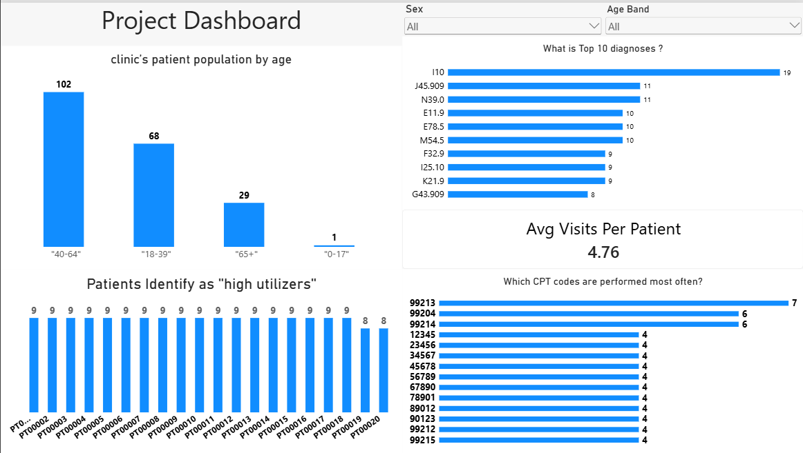

# Patient Analytics & Clinical Operations

## Overview
This project provides a comprehensive analysis of clinical patient visits, demographic distributions, diagnostic patterns, high-utilizer behaviors, and procedure frequencies. Built using Power BI, the dashboard translates raw healthcare visit logs into actionable insights to optimize clinical operations, resource allocation, and patient care management.

---

## Dashboard Preview

---

## Key Questions Answered & Insights

### 1. Patient Demographics by Age
* **Question:** What does the clinic's patient population look like by age?
* **Insight:** The primary patient demographic falls within the **40–64 age band** ($102$ patients), followed by **18–39 years** ($68$ patients), **65+ years** ($29$ patients), and **0–17 years** ($1$ patient). 

### 2. Top Diagnoses Overall
* **Question:** What are the top diagnoses overall?
* **Insight:** 
  * **ICD Code `I10` (Essential / Primary Hypertension):** Top diagnosis across the clinic with $19$ patient visits.
  * **ICD Code `J45.909` (Unspecified Asthma, Uncomplicated):** Second most common with $11$ visits.
  * **ICD Code `N39.0` (Urinary Tract Infection, site unspecified):** Tied for second with $11$ visits.

### 3. Patient Utilization & High Utilizers
* **Question:** How many visits does the average patient have, and who are the high utilizers?
* **Insight:** 
  * **Average Visits Per Patient:** **$4.76$ visits**.
  * **High Utilizers:** Patients identified with high utilization (defined as having $4$ or more visits) generally average $9$ visits per patient, with a few reaching $8$ visits (e.g., patient IDs `PT00001` through `PT00020`).

### 4. Most Frequent CPT Codes (Procedures)
* **Question:** Which CPT codes (procedures) are performed most often?
* **Insight:** 
  * **CPT Code `99213`:** Most frequently performed code ($7$ instances), corresponding to an *Office/outpatient visit for an established patient (Moderate complexity, ~15 mins)*.
  * **CPT Codes `99204` & `99213`:** Tied for second with $6$ instances each (New patient visit / Established patient visit of higher complexity).

---

## Key Metrics Summary

| Metric | Value |
| :--- | :--- |
| **Primary Age Demographic** | 40–64 years old ($102$ patients) |
| **Average Visits / Patient** | $4.76$ visits |
| **Top Diagnosis Code** | `I10` — Essential Hypertension ($19$ visits) |
| **Top CPT Code** | `99213` — Outpatient Visit, Established Patient ($7$ procedures) |

---

## Dataset & Files Structure

* **`Dashboard.png`**: Visual snapshot of the Power BI dashboard layout and charts.
* **`patient_visits_2.csv`**: Raw dataset containing patient records, visit dates, age bands, sex, ICD diagnosis codes, and CPT procedure codes.
* **`Project Q and A.pdf`**: Source document detailing project questions and key analytical findings.

---

## Technical Stack & Tools

* **Business Intelligence:** Power BI
* **Data Processing:** Power Query / Data Analysis Expressions (DAX)
* **Data Source:** CSV File (`patient_visits.csv`)
